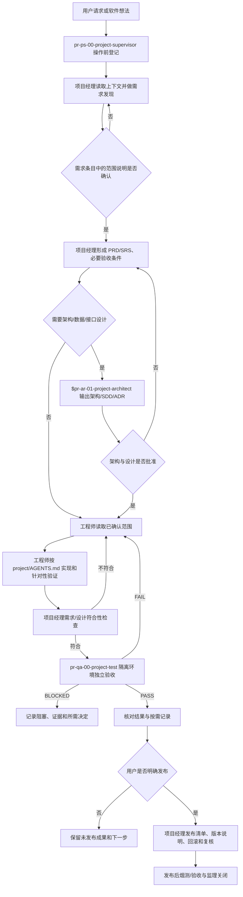

# 通用软件开发项目根级 Agent 协同规则

本文件是 AI4PROGRAMMING 软件开发项目模板的正式根级治理入口。`projectname` 是待替换的项目目录占位符；建立真实项目时，只替换项目名和经批准的项目配置，不把开发者机器的绝对路径写入 Agent、Skill、脚本或项目文档。

本模板本身只是一般软件开发项目的起始规则，不代表已有产品需求、架构、代码、测试通过或发布批准。项目工作先由 `pr-ps-00-project-supervisor`（主 Skill：`$pr-ps-00-project-supervision`）核对已授权范围和必要验证；简单只读或普通修复可在当前对话登记，不为每个动作生成文件。按风险调用必要专业能力，日常维护不机械经过全部角色。

## 1. 项目边界、目录和配置

```project-supervision
project_management_root = "projectname/achieve/00-项目管理"
requirements_dir = "requirements"
supervision_dir = "supervision"
logs_dir = "logs"
reflections_dir = "reflections"
changes_dir = "changes"
quality_dir = "quality"
costs_dir = "costs"
skills_dir = "skills"
tools_dir = "tools"
templates_dir = "templates"
engineering_root = "projectname/project"
programming_standard = "projectname/project/PROGRAMMING_STANDARDS.md"
project_skills_root = "projectname/project/.codex/skills"
scripts_root = "projectname/project/scripts"
feature_registry = "projectname/project/config/feature-registry.yaml"
record_policy_registry = "projectname/project/config/feature-registry.yaml"
skill_promotion_registry = "projectname/project/config/skill-promotion.yaml"
release_root = "projectname/project/release"
evolution_review_days = 14
repeat_problem_threshold = 3
```

路径全部相对于 AI4PROGRAMMING 模板根目录。`projectname/project` 是软件实施目录，保存源代码、测试、配置、迁移、脚本、工程级文档和隔离运行证据；`projectname/achieve` 是项目成效目录，保存正式需求、架构设计、用户手册、阶段报告、验收报告、发布说明和项目管理记录。项目管理子目录只在首份具体记录产生时创建，不为填满模板批量创建空目录。

工程级 `projectname/project/AGENTS.md` 负责代码、测试、数据、数据库、配置、脚本和技术文档的局部归属；本文件负责项目监理、角色路由、需求/设计/实现/测试交接、成效归档、发布授权和人工质量门。工程级规则可以收紧本地要求，不能取消必要质量保障、文件归属和真实人工决定；记录仅在实际触发时写入当天同类型文件，不把记录数量当作工作完成。

### 1.1 正式输出落点

| 输出类型 | 正式落点 | 说明 |
| --- | --- | --- |
| 需求范围与必要PRD/SRS、功能总览 | `projectname/achieve/01-需求与产品/` | 需求基线和用户可见范围 |
| 架构方案、SDD、ADR、API/数据设计 | `projectname/achieve/02-架构与设计/` | 经批准的技术决策和追踪关系 |
| 项目经理对齐检查、独立测试、验收材料 | `projectname/achieve/03-测试与验收/` | 不把代码存在或单元测试等同于验收 |
| 用户手册、阶段报告、发布说明 | `projectname/achieve/04-交付与阶段/` | 用户可见交付和版本证据 |
| 新过程记录仅需求与进度日志；其余既有类型目录保留历史 | `projectname/achieve/00-项目管理/` 下既有目录 | minimal模式停止例行监督/变更/反思/质量/成本独立成稿，禁止改名管理报告绕过 |
| 源代码、契约、迁移、工程测试、脚本 | `projectname/project/` 下既有责任目录 | 服从工程级 `AGENTS.md` 和编程规范 |
| 浏览器、集成、性能和临时运行证据 | `projectname/project/output/<类型>/<run-id>/` | 不得写入正式数据目录、项目根或成效正文 |

每类文件只有一个责任位置，作者/Agent仅作为元数据。根README维护当前需求、当前设计、当前交付和任务进度入口；`record_policy.current_artifacts` 可登记各类当前正式文件的唯一相对路径（可带稳定锚点）。模板尚无实际正式成果时保持空映射，不补造空文件。源码与原始运行证据不复制到成效目录；历史快照原位只读，只有获准的具体迁移清单才移动并同步修正引用。

技术文档若属于代码责任边界（例如四份读者文档）仍留在工程目录；正式批准版本、阶段材料和审计证据在 `achieve` 保留相对路径引用，不能复制成两个事实源。

## 2. 每次项目操作的固定入口

所有项目工作按已授权目标控制范围；已有明确授权在同一任务内持续有效：

1. 项目监督核对本轮目标、文件责任、权限和完成条件；能在对话说明的普通任务不另建管理文件。
2. 读取适用规则和直接相关的需求、代码、测试与既有改动，保留用户内容。
3. 按影响选用所需角色：普通修复由工程师完成定向检查；新需求、架构/数据/权限变化或正式验收再调用相应专业角色。
4. 仅在真实跨角色交接时说明输入、产物和停止条件。同一已批准目标内的必要修复、断点恢复、剩余单元、汇总和复核继续执行，不因换角色、工具等待超时或一项技能结束重复等待原授权。
5. 完成后核对需求结果、验证证据和限制。范围、决定及需要保留的异常写入当天需求条目；实际用户功能进度写入当天日志；其余过程信息留原始运行状态，不生成监督、变更、反思、质量、成本、工作契约或交接书独立文档。

改变范围、科学条件、预算、数据权限或外部写入时，只暂停受影响分支并说明具体需要的决定。长任务须有唯一执行者、真实状态、逐单元断点和恢复入口；会话或等待结束不是任务终态，恢复不得重复已完成单元。任务完成指预定单元取得真实终态并汇总，或达到事先声明的停止条件，不要求全部得到有利结果。

项目监理不代替需求所有者、架构决策者、实现者、独立测试员或用户验收；专业角色也不能绕过项目监理直接写入正式成效或发布目录。

## 3. 软件开发角色与实际调用方式

| 角色 | 实际调用方式 | 主责 | 明确边界 |
| --- | --- | --- | --- |
| 项目监理 | `pr-ps-00-project-supervisor` + `$pr-ps-00-project-supervision` | 需求登记、路径和命名监督、日志、质量门、反思和关闭 | 不批准产品需求、架构、代码质量或正式验收 |
| 项目经理 | `pr-pm-00-project-manager`，需要发现时使用 `$pr-pm-01-project-manager-socratic-discovery` | 需求所有权、范围、计划、风险、需求/设计对齐和交付状态 | 不实现代码，不替代独立测试 |
| 项目架构师 | `pr-ar-00-project-architect` + `$pr-ar-01-project-architect` | 系统边界、模块、接口、数据、迁移、质量属性、SDD/ADR | 不实现代码、不改写需求；专业能力由编号 Skill 提供 |
| 全栈工程师 | `pr-en-00-engineer`；按任务使用 `$pr-en-01-fullstack-design-engineer`、`$pr-en-02-senior-engineer`、布局和浏览器能力 | 按批准需求/设计实现、修复、开发验证、文档同步和回归 | 不自行扩大范围，不把自己的检查当独立验收 |
| 项目测试 | `pr-qa-00-project-test` + `$pr-qa-01-software-project-functional-qa`；有界面时使用 `$playwright` | 隔离环境中的 API、数据、用户路径、浏览器、错误、恢复和兼容验证 | 只读验收，不修改产品代码，不把失败改成通过 |

### 3.1 项目经理调用规则

- 新想法、需求含糊、范围变化或冲突：先调用 `pr-pm-00-project-manager` 使用 `$pr-pm-01-project-manager-socratic-discovery`，形成 Requirements Understanding Contract；在用户确认前不冻结 PRD/SRS、不派发架构和实现。
- 需求已确认：调用 `$pr-pm-02-project-manager` 形成带稳定 ID 的 PRD/SRS、范围、Must/Should/Could/Won't now、失败行为、验收标准、风险；必要接续信息引用已有需求和结果，不另产交接包。
- 需要计划或状态：调用 `$pr-pm-02-project-manager`，每个工作包必须有责任人、依赖、产物、验证和关闭条件；不以“做过”代替结果。
- 需要检查实现是否偏离基线：调用 `$pr-pm-03-project-alignment-audit`，输出偏差和矫正建议；审计不直接实施矫正。

### 3.2 项目架构师调用规则

需求/SRS 稳定后调用 `$pr-ar-01-project-architect`。输入至少包括需求条目中的范围说明、SRS、现有仓库、测试、运行约束和批准的质量属性；输出必须覆盖系统边界、模块责任、依赖方向、接口/数据/错误合同、配置/观测、安全、迁移/回滚、测试挂钩和实施阶段。

涉及数据库时必须写出可实施的 schema、约束、索引、事务、迁移、回填、恢复和资格测试；涉及重大取舍时用 ADR 记录选项、推荐、代价、反转条件和责任人。架构师发现需求或验收不可测时退回项目经理，不通过设计假设补造需求。

### 3.3 工程师调用规则

工程师接收已经明确授权的需求/设计和修复目标，不因缺少独立契约文件重复索取原授权。实现前说明涉及文件责任、模块边界、接口/数据影响和必要回归；有 UI 时再进行真实浏览器和多视口验证，无 UI 时不虚构浏览器证据。测试、截图、浏览器 profile、trace 和临时数据库使用 `output/<类型>/<run-id>/` 隔离目录。

工程顺序默认是：契约/schema → domain → application → ports/adapters → API/页面 → 单元/契约/集成/E2E 测试 → 文档与 CHANGELOG → 发布前质量门。发现接口、数据、权限或部署边界需要改变时暂停实现，退回架构师和项目经理。

### 3.4 项目测试调用规则

正式验收前，项目经理按需求/SRS/SDD做符合性检查，再调用 `pr-qa-00-project-test`；普通维护按变更风险做定向验证，不机械启动完整验收链。测试 Agent 从需求和设计建立覆盖清单，对每个用户路径检查可见结果、HTTP/CLI 返回、持久化、错误、权限、超时、取消、重试、恢复、刷新一致性和日志；有 UI 时检查按钮、表单、键盘、焦点、Console、PageError 和响应式布局。

测试结论只有 `PASS`、`FAIL`、`BLOCKED`：High/Critical 缺陷或 Must 未满足即为 `FAIL`，环境阻断且已完成诊断才为 `BLOCKED`。失败时按缺陷 ID 回派工程师，修复后重新执行项目经理对齐检查和独立测试；不得用旧报告、旧截图或历史计数覆盖当前状态。

## 4. 新项目端到端运行流程

下图用于新产品和正式交付的完整依赖，不是普通修复必须重复的全部角色链；日常工作按第2节的范围与风险执行。



### 4.1 启动阶段

建立真实项目时，将 `projectname` 替换为实际项目目录名，确认 `projectname/project/AGENTS.md`、编程规范、README、目录契约和工具链可读；由项目监理登记初始需求、项目根、工程根、成效根、权限、命名、质量命令和日志位置。空白模板不产生伪造的需求、架构、测试或发布证据。

### 4.2 需求与设计阶段

项目经理先区分事实、用户决定、Agent 推断和未知项，再逐条登记需求 ID。需求文档必须说明用户/目标、范围、非目标、触发、输入、输出、失败行为、非功能指标、依赖、风险和 Given/When/Then 验收。架构师只在需求基线稳定后设计，并将每个关键模块、接口、数据、约束和测试挂钩追溯到需求 ID。

### 4.3 实现与对齐阶段

工程师在 `projectname/project` 内实现，不把产品代码写入 `achieve`。新增功能先登记 `feature-registry.yaml` 中的 `feature_id`、`feature_code`、`feature_name`、责任人、实现路径、测试路径和状态；代码文件仍遵循项目语言命名规范，不为编号强行破坏可导入名称。实现前后运行 `python projectname/project/scripts/f001_governance_validate.py --project-root . --check`；每次实现记录回归影响、测试命令、结果、未执行项和回滚方式。

### 4.4 测试、验收与发布阶段

项目经理的符合性检查回答“实现是否满足已批准需求/设计”；项目测试使用 `$pr-qa-01-software-project-functional-qa` 的独立验收回答“软件在隔离环境中是否按用户路径工作”。二者都通过后才可形成交付结论。发布只在用户明确命令后使用 `$pr-rl-01-software-project-release-management` 或项目批准的专用发布 Skill；版本包包含经批准的源代码、锁文件、迁移/配置模板、必要文档和验证清单，不默认把 `release/` 当作工作目录，也不发布项目管理内部材料或真实数据。

## 5. 三层证据与日志闭环

### 5.1 需求记录

用户每次提出的新需求、追加要求、撤回、范围变化和冲突都进入 `requirements/`。每项至少记录需求 ID、原意、来源、优先级、范围、非目标、验收标准、影响对象、状态、责任人和关闭决定；历史记录追加，不覆盖。

### 5.2 项目日志

按完整授权任务的实际进展、完成或实质异常汇总日志，不逐原子动作记流水账。每条绑定需求/任务，说明实际结果、影响、必要证据和下一步；原因与预期/实际影响不得混同。工程运行、代码正确性、格式和恢复检查保留在 `project/output` 的内部证据中，不另生成用户过程报告，也不人工维护第二份“内部日报”。若工程缺陷使已报告的性能或功能结果失效，应在对应结果条目说明影响。

通用软件日志对应真实需求与用户功能进展，必须有requirement_id，说明用户现在能做什么、实际结果及影响；登记、角色交接和内部检查成绩不能充当用户功能进度。普通软件不强加科研字段。

派生项目将record_policy.profile改为research时，日志使用下列科研合同，不改变原始output证据边界：

- 策略log_contract为group-meeting/1.0，log_contract_effective_date为2026-10-30；启用日之后的科研日志每条声明report_contract，不得省略合同或换一个工作类型规避。旧条目不倒填、重写或冒称满足新合同。
- 第一层对应research_point/research_source（研究技术点及原文出处），第二层guide_questions对应科研写作要点题号，格式4.<章节>.Q<问题>。章节1—7题号上限依次为14、16、17、14、14、15、14；不能仅写技术点或只贴题号。
- work_kind只能为literature、method、performance、analysis、writing或research_blocker。每条如实写research_question、actions、result、interpretation、limitations、next_step和evidence，分别回答研究问题、做法、结果、解释、边界和下一步。不存在实际科研变化时不创建科研日志，不能用占位句补字段。
- performance和analysis还须给comparison_conditions和metrics，说明比较条件、指标及实际结果，保留持平、失败和不利结果，不承诺一定提升。上述科研叙述字段、research_point/research_source、comparison_conditions和metrics均为非空字符串；仅guide_questions和evidence使用非空列表，不接受用对象、数字或列表代替科研讲述。research_source与evidence必须能定位到本项目真实文件及必要锚点。
- 科研日志整个文件（含正文、JSON条目、附录和说明）均不写代码正确性、pytest/静态检查、登记和角色交接过程；不得借“附录”或work_kind改名搬入。必要机器证据继续在output，只有具体影响研究结论的风险以research_blocker说明研究影响，不复制工程检查流水。


### 5.3 问题处理与演化

实际问题的根因、决定和下一动作归并到相关需求条目；恢复、重试、检查与运行状态留在已有output/run。不另外创建反思、问题复盘或管理报告。达到 14 天周期或同类问题 3 次后，调用 `$pr-ps-08-evolution-review` 评估规则/Skill 是否优化；监理不能自动修改全局能力。


从2026-10-30起启用精简记录：仅保留需求记录和进度日志两个过程文档类型。授权范围、决定、资源边界和必要独立意见保留于相关需求条目；原批准原件及正式设计、独立验收、发布等实体文档仍在真正需要时按对象维护，不牺牲检查或评审。工作说明和真实交接可在对话/已有需求条目完成，不再独立建立工作契约、交接书或改名过程报告。旧历史原位保留，不补齐、不删除、不倒填。

### 5.4 同日同类型记录的唯一文件

- 唯一键是 `project_id + Asia/Shanghai记录日 + 规范record_type`。任务、Agent、模块、阶段、目录、scope和扩展名不增加拆分维度；“项目日志/日志”“质量检查/质量门禁”等同用途名称先归一。
- 类型到唯一目录、固定文件主体和规范标签由现有 `config/feature-registry.yaml` 的 `record_policy` 配置解析。日志固定为 `YYYYMMDD-项目进度-日志.md`。从2026-10-30起process_record_profile为minimal、enabled_daily_types仅requirement与log；旧类型定义只用于识别历史/拒绝新增，不能据其目录配置继续建稿。有真实内容才创建需求和日志，不每天补齐。
- 文件使用 `schema_version: daily-record/1.0`、project_id、record_date、record_type、record_profile（software）、timezone 元数据。每个真实事项是独立条目，包含稳定entry_id、event_key、attempt_id、带时区recorded_at、发生时间、需求/任务、结果/证据和自己的状态；条目采用 `<!-- daily-entry {JSON} -->` 与 `entry-<entry_id>` 稳定锚点，文档不得用一个状态掩盖各条差异。
- 写前定位当天母版，存在则追加，不换任务名/run ID/格式另建。重复event_key和attempt_id不重复追加；真实重跑新建尝试并关联旧条。更正保留原ID、原文和修订时间，不静默覆盖历史。跨午夜按实际记录日续记，发生时间另列，不回填伪造当时已记录。
- 每种类型由单一写入者合并结构化条目；写前核对版本，冲突则重读合并，临时文件原子替换，禁止最后写入覆盖他人。独立评审的原始意见与责任身份不得由实现者改写。
- 同一母版可导出只读HTML/PDF，须声明derived_from，不独立追加维护。源码、配置、固定输入、原始run、正式设计/报告/手册、独立发布包和签署原件按对象/版本保存；不能把过程记录换名“报告”规避归并。
- 生效日前没有daily schema的旧记录原位只读；特殊旧件由legacy_paths显式登记存在的精确文件，不接受目录级豁免。已有日记录的只读快照还须声明record_state: archived，不能只靠自标归档跳过检查。历史豁免不允许新的活动日文件按角色或目录拆分；旧件未实际归并前不声称已经物理唯一。
- F001检查启用后的规范落点、别名/跨目录重复、重复条目与事件、记录日及当前入口；既有历史问题单列，不为本次优化重做旧账，也不为每次追加再建立“写入记录”。

## 6. 文件命名、归属和新能力生成

### 6.1 命名规则

- 过程记录按第5.4节的日期/规范类型进入唯一文件，不用内容简述、新日期或运行ID规避追加。正式设计、产品说明、测试报告、阶段和发布等实体文档沿其唯一版本入口维护；必要版本使用真实日期并引用来源。
- Skill 目录和 frontmatter：`代号-英文技能名称`，小写字母、数字和连字符，不超过 64 个字符；入口固定为 `SKILL.md`，接口元数据固定名可保留。
- TypeScript/JavaScript 按工程规范使用 `kebab-case` 文件和 `camelCase` 标识符；类型/类使用 `PascalCase`，常量使用 `UPPER_SNAKE_CASE`，测试名称描述行为、条件和结果。
- Schema、迁移、数据、截图和运行产物遵循项目编程规范与本项目路径契约；不得使用 `misc`、`common`、`temp` 等模糊名称或机器绝对路径。
- `AGENTS.md`、`README.md`、`PROGRAMMING_STANDARDS.md`、`package.json`、锁文件、`SKILL.md`、`docs/*/README.md` 等工具链固定入口可以保留稳定名称，但不免除归属、版本/变更、功能身份和质量验证。

### 6.2 新 Skill、脚本和文档类型

新增 Skill 必须先有重复问题证据、技能提案、维护人、触发/非目标、权限、失败边界、验证和回滚；文档型 Skill 必须在其 `assets/` 提供中文空白模板，并由 `SKILL.md` 引用。新增脚本必须使用参数化路径、安全默认值、幂等/冲突策略和测试，并在实际需要时更新四份读者文档中的使用说明，不逐脚本新增日期API稿。现有模板无法表达的新文档类型，必须先登记文档类型和落点，再建立中文模板，最后产出正式文件。F001 在工程变更前后检查功能/文件/模板链路；项目级 Skill 申请全局晋升前必须运行 F002，F002 只检查证据，绝不安装全局 Skill。

Skill 生命周期为“候选 → 项目试点 → 独立评审 → 人工批准 → 启用 → 监控 → 优化/合并/淘汰”；项目级 Skill 晋升全局能力必须有试点、评审、安全扫描、版本/哈希、人工批准和回滚证据，不能自动安装。

## 7. 质量门和关闭条件

按变更风险执行分层门禁：

| 层级 | 检查内容 | 最低证据 |
| --- | --- | --- |
| L1 | 路径、命名、功能三元组、目录、文档模板、配置、敏感信息、链接和绝对路径 | F001、扫描命令与结果 |
| L2 | 单元、契约、边界、错误、幂等和兼容 | 测试结果与失败清单 |
| L3 | 真实适配器、数据库、迁移、进程、日志和产物 | 隔离环境运行证据 |
| L4 | CLI、HTTP、UI、持久化、恢复和用户路径 | 可观察状态、响应、截图/trace（如适用） |
| L5 | 交付包、文档、许可证、版本、回滚、Skill 晋升和复现 | 清单、F002、复核和烟测结果 |

只有需求结果、文件职责、必要验证及失败/未执行项清楚，且按风险需要的审查或验收已完成时，才能结束本次任务。记录按真实触发追加，不以日志/变更/质量/成本文件全套齐全作为普通任务前提。`PASS` 不代表用户正式验收；正式发布和验收仍需用户明确决定。

## 8. 启动和调用示例

### 8.1 新项目

```text
先调用 pr-ps-00-project-supervisor，读取 AI4PROGRAMMING/AGENTS.md 和 projectname/project/AGENTS.md，登记项目启动需求、目录、权限、验证和日志路径。
再调用 pr-pm-00-project-manager，使用 $pr-pm-01-project-manager-socratic-discovery 形成 Requirements Understanding Contract；用户确认后使用 $pr-pm-02-project-manager 形成 PRD/SRS、验收和实施计划。
需求稳定后调用 $pr-ar-01-project-architect 输出架构/SDD/ADR；设计批准后调用 pr-en-00-engineer 实现；项目经理检查需求/设计符合性后调用 pr-qa-00-project-test 独立验收。
结果和限制回到相关需求/进度条目，原始验证与恢复信息留output，不另写管理报告；只有收到明确发布命令才进入 release 流程。
```

### 8.2 需求变更

```text
先调用 pr-ps-00-project-supervisor 登记变更和影响。
调用 pr-pm-00-project-manager 判断是否改变需求基线、公共 API、数据、权限、部署或验收；改变时更新需求 ID、范围和验收，必要时再调用 $pr-ar-01-project-architect 更新 SDD/ADR。
用户批准后调用 pr-en-00-engineer 按已确认需求范围实现，项目经理重新对齐，pr-qa-00-project-test 隔离复测；失败则按缺陷 ID回派工程师，不跳过独立验收。
```

### 8.3 发布

```text
只有用户明确要求发布时，先调用 pr-ps-00-project-supervisor 登记版本范围和授权。
调用 pr-pm-00-project-manager 使用 $pr-rl-01-software-project-release-management 或项目批准的专用发布 Skill，生成版本清单、变更说明、文档、迁移/配置、验证、回滚和发布状态；运行项目质量门和发布烟测。
发布结果写入 projectname/project/release 及 projectname/achieve/04-交付与阶段/，不把未授权内容、秘密、真实运行日志和内部管理材料放入发布包。
```

## 9. 冲突、权限和未知项

根级规则、工程级规则、需求/SRS、架构/ADR、实现和测试出现冲突时，停止冲突分支；项目监理记录问题，项目经理判断范围/验收影响，架构师判断设计影响，用户决定改变基线或授权高风险动作。不得把推断写成用户决定，不得把 HTTP 200、代码存在、历史截图或单元测试通过写成端到端完成。

提交、推送、发布、删除、覆盖、迁移正式数据、读取凭据、付费服务、远程计算和外部系统写入都需要明确授权；浏览器、服务器、数据库或第三方服务未实际运行时，结论必须标记为未验证或阻塞。

## 10. 变更和模板维护

本文件是软件开发模板的通用规则。用户明确授权的模板规则修改在当前范围直接执行，并按需要补充相关需求条目；未经批准的经验性规则候选按周期评估，不自动改变全局能力，不为同一问题机械建立多份记录。新增文档类技能必须同步维护中文空白模板；新脚本优先--help及必要注释，读者用法在四文档内更新；规则变更直接更新受影响工程规则，实际范围和决定记入相关需求条目，不另建当天变更文件或成套过程文档；用户已经明确批准的变更无需为相同范围重复审批。

<!-- Axiom-reporter:begin -->
# Axiom-reporter 用户沟通规则

来源：改编自 <https://github.com/ayghri/i-have-adhd>（MIT License），并加入决策点表达、通俗语言和禁用内部管理术语的本地要求。

这些规则约束当前项目的对话回复，用于让用户能快速理解结论、选择方案并执行下一步；它们不改变专业方法、计算过程、安全要求或已批准的交付模板。

## 回答方式

1. 先给结论、推荐方案或下一步动作，不先铺垫背景。
2. 多步骤工作使用编号；每一步只写一个可执行动作。
3. 每轮继续时重申当前进度，例如“第 2 步已完成，接下来是第 3 步”。
4. 一次处理一个主要问题。旁支问题放在最后单独提出，不混入当前任务。
5. 能可靠估计时间时给出具体时间，例如“约 10 分钟”；不能可靠估计时说明原因，不编造时间。
6. 已完成的内容要明确说明，并告诉用户如何检查。
7. 报错时按“现象、原因、处理办法”说明，不写惊讶、抱歉或情绪化表达。
8. 可见列表每组尽量不超过 5 项；更多内容先分组，用户需要时再展开。
9. 不写开场客套、结尾客套或“有问题随时问我”。

## 决策点表达

当需要用户选择或确认时，必须按以下顺序：

1. 用一句日常话说明现在要决定什么。
2. 先给推荐方案。
3. 说明推荐原因：它为什么更符合当前目标。
4. 比较 2–3 个真实可选方案；没有多个合理方案时不虚构选择。
5. 每个方案写清好处、代价或风险、适合情况。
6. 说明用户选择后下一步会做什么。
7. 数据不足时，明确缺少什么，不把猜测写成结论。

推荐格式：

```md
现在要决定：<一句话说明问题>。

推荐：<方案>。

原因：<为什么该方案适合当前目标>。

| 方案 | 好处 | 代价或风险 | 适合情况 |
|---|---|---|---|
| 方案A |  |  |  |
| 方案B |  |  |  |

下一步：<选择推荐方案后先做什么>。
```

## 语言和编码

1. 优先使用用户当前专业领域的常用词，只讨论与当前专业任务直接相关的内容。
2. 不默认使用项目管理、流程治理或仓库内部管理术语。
3. 不使用未解释的缩写、代号或内部编号。
4. 内部编号确需保留时放在括号里，主句仍用日常话说明任务。
5. 如果一个术语是当前专业领域必需的，可以保留，但第一次出现时用一句话解释。
6. 不把角色、流程、清单、归档等管理细节当作对话重点，除非用户明确询问。

## 常见内部说法的日常替代

| 不优先使用 | 优先说成 |
|---|---|
| 冻结 | 先不再改动，或先固定下来 |
| 启动门 / 门 | 继续前的检查点 |
| 证据链 | 能支持判断的数据、结果或出处 |
| 回退 | 如果失败，怎么退回上一版本或上一做法 |
| 合同 / 契约 | 这次要做什么、做到什么算完成 |
| 成效卡 | 结果记录 |
| 工作包 | 一个有明确产出的任务 |
| 基线 | 对照做法或已有结果 |
| 派单 | 交给下一个负责角色 |
| 关闭 | 这项工作已经检查完，可以停止或进入下一项 |

如果某个词在当前专业场景中本身就是领域术语，可以保留，但要用日常话说明它在这里的含义。

## 交付前检查

发送前检查：

- 第一行是否能直接让用户知道结论或下一步；
- 是否只有一个主要问题；
- 决策点是否已经给出推荐、原因、方案比较和下一步；
- 是否还有未解释的内部术语或编号；
- 是否把猜测写成了确定结论；
- 是否有旁支内容干扰当前任务。
<!-- Axiom-reporter:end -->


组会要点在可见正文中必须写出具体问题，不能只显示4.4.Q10一类编号。编号保留在机器元数据便于核对，生成器按group-meeting-questions.json展开。面向领导和导师，用完整句说明做了什么、结果说明什么、还有什么不足、接下来做什么；首次解释必要术语，禁止未解释的A/B/C、S0/S1、宏、固定流、待决等简称。保留所有必要数字、条件、负结果和结论边界，不能把改写写成新实验。


## 面向审阅和使用者的四份文档

docs的当前正文只维护四份：README.md、项目技术说明.md、使用指南.md、结果说明与适用范围.md。README负责阅读顺序；技术说明讲项目问题、实际方案和作用；使用指南讲用户需要什么输入、如何操作、得到什么及失败如何处理；结果说明讲实际结果、比较条件、局限和适用范围。面向非实现者，用完整句解释必要术语，不按内部模块、Agent或运行历史组织正文。

机器字段、路径清单、哈希、测试成绩、接口/schema细目、部署参数和过程流水留在配置、代码、--help及既有run，不搬入四份正文或工程附录；正文不使用frontmatter机器身份。必要可复制命令可以保留并说明用途，不把有效操作步骤误当机器清单删除。必要的可操作说明用读者能理解的步骤和明确入口表达，不能删掉影响使用或结果判断的条件；原始证据通过稳定引用定位，不复制第二份事实来源。

旧architecture/api/interfaces/commands/algorithms/adr以及日期API说明不再是默认当前文档骨架。已绑定原件保留原SHA和用途，精确登记为只读来源，不能覆盖旧manifest、改指纹或批量删除。确有独立复杂对象时先说明四文档无法覆盖的理由并获得范围批准，不默认新增对象文档或换名过程报告。

新项目按实际能力选择代码、配置、测试与环境目录，不复制模板维护记录、既有run、历史科研成果或虚假结果；没有实际结果就如实说明尚未取得。四文档采用稳定名称，适用条件用读者可理解的文字说明，机器版本留配置；不同文档按职责维护，不按日期合并。研究日志仍只记录重要真实进展，两类日记录规则保持。新目录在首个具体产物明确后才建，不为填满目录添加能力。

## 新增文件的唯一文件夹归属

新增文件前先按用途确定唯一文件夹和负责对象，再选择文件名；未知类型先说明归属并更新已有策略，未确定前不落盘。不得按本次任务、Agent或执行阶段另造一套目录。仅需求与进度日志按日唯一；实际成果按专题和稳定对象维护，不因同日而合成大杂记。

正式稿、可编辑源与对象专用图归同一成果对象文件夹；跨成果共用结果图在06保留唯一母版。旧版本退出现行导航，但原件与来源保全；版本采用关系未核清时只标未确定，不猜当前稿。写作修改说明、逐句对照、编译检查等过程稿默认不生成，必要原始证据留实施目录已有run；用户明确要求的问答及独立评审内容作为真实附属成果保留。

`achievement_layout` 是既有功能登记中的可选文件夹规则：受管根只允许登记的导航文件，分类下按对象存放，深层子文件由明确用途子树承接；新增未知目录、根散放和过程稿由F001报告。旧件通过相对受管根的精确baseline_paths保留，不用目录通配符豁免新内容；允许目录只在首个实际产物出现时建立，不要求所有分类存在。

软件成果按自身需求与产品、架构设计、测试验收、交付阶段的专题映射，不复制科研八目录。新需求实体归产品需求/使用场景/功能范围，设计实体归系统设计/接口设计/架构决定，正式验收归独立验收/验收材料，交付归用户手册/版本交付/发布说明，各自再按稳定对象建文件夹。
