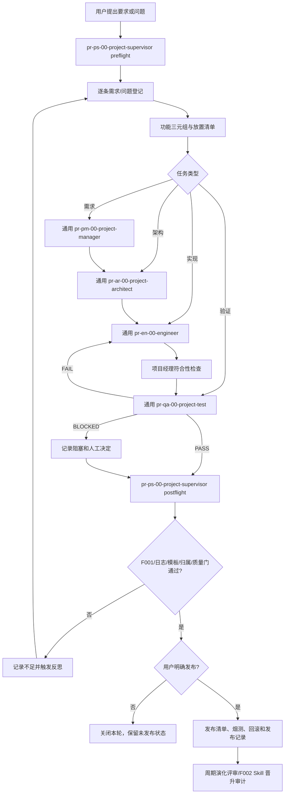

# AI4PROGRAMMING 治理要求对齐审计

## 1. 审计依据与范围

### 1.1 控制基线

本次按以下优先级判断：用户本轮明确提出的八项要求 > 当前根级 `AGENTS.md` > 工程级 `projectname/project/AGENTS.md` 和 `PROGRAMMING_STANDARDS.md` > 机制说明 v1.1 > 历史兼容 `agent.md`。机制说明状态为“待用户审核”，因此只作为候选说明，不反向覆盖用户要求或实际 Agent 配置。

检查对象包括：

- `AI4PROGRAMMING/AGENTS.md`；
- `AI4PROGRAMMING/agent.md`；
- `projectname/project/AGENTS.md`；
- `projectname/project/PROGRAMMING_STANDARDS.md`；
- `projectname/project/config/feature-registry.yaml`；
- `20260913-AI4PROGRAMMING项目治理与软件开发流程-机制说明.md` v1.1；
- 当前项目管理需求、监督、日志、质量、变更、成本和模板记录；
- 全局 `pr-ps-00-project-supervisor`、`pr-pm-00-project-manager`、`pr-ar-00-project-architect`、`pr-en-00-engineer`、`pr-qa-00-project-test` 的实际配置；
- 根级流程直接调用的主要文档型 Skill 及其 `assets/`。

### 1.2 证据限制

- 当前 `projectname/project` 是空白工程模板，应用源码和测试源码扫描数均为 0；功能注册表为 `features: []`。
- 当前没有真实项目级 Skill、脚本工具、发布包或端到端 Agent 派发记录。
- 未运行真实服务、浏览器、数据库、迁移、性能、安全或发布测试。
- 本审计可以判断规则、配置、模板和现有记录是否存在，不能据此证明派生项目一定会正确执行。

## 2. 结论摘要

**总体判定：有风险（AT_RISK）。**

八项要求均已在根级规则或机制说明中得到不同程度的表达，但只有“日志必须写为什么做、影响是什么”同时具备规则、模板和本批实际记录证据。其余七项至少存在一种缺口：只有规则没有自动校验、只有空模板没有真实实例、实际全局 Agent 仍绑定特定科研项目，或历史流程尚未经过通用软件项目端到端试点。

目前最严重的问题不是缺少流程图，而是“通用软件流程调用了非通用的实际 Agent”：全局 `pr-pm-00-project-manager`、`pr-en-00-engineer` 和 `pr-qa-00-project-test` 仍明确面向 `scienceresearch`，包含固定科研工作台路径、Skill 和交付要求。这会使新软件项目在实际派发时偏离根级 `AGENTS.md` 的通用目标。

## 3. 八项要求逐条判定

| 编号 | 要求 | 判定 | 已有实现 | 主要缺口 |
| --- | --- | --- | --- | --- |
| R1 | 所有类型文件和代码标识符有命名规范；功能性文件有“编号 + 代码 + 功能” | 部分覆盖 | 文档日期化命名、TypeScript/JavaScript 文件和标识符规则、固定入口例外、功能注册表三元组已定义 | `features` 为空；没有只读校验器检查重复、格式、实现/测试路径和未登记功能文件；无法证明所有功能性文件都已绑定三元组 |
| R2 | 所有新文件明确去处归属 | 规则覆盖，执行待验证 | 根级成效目录矩阵、工程级目录契约、写入前放置清单和冲突处理已定义 | 没有机械化目录允许列表或越界检查；当前空白模板无法验证真实文件放置 |
| R3 | 执行时生成日志；用户要求全部登记；不足进入反思 | 部分覆盖 | 监理前置需求登记、后置日志/质量/变更/成本和反思触发规则已写入，本批有实际记录 | 依赖 Agent 主动遵守，不是后台拦截；没有自动核对“本轮用户要求数 = 已登记需求数”；历史操作完整性无法证明 |
| R4 | 所有文档输出都有规范和模板，模板跟随 Skill | 部分覆盖 | 项目监理、项目经理、架构、工程交付、对齐审计等主要 Skill 有中文模板；本审计直接使用 Skill 内模板 | 没有全量文档型 Skill 清单和自动审计；机制说明的专用模板位于项目 `templates/`，没有随一个项目级 Skill 的 `assets/` 保存，严格按“模板跟随 Skill”仍未完全闭环 |
| R5 | 除具体实例外不新建文件夹 | 部分覆盖 | 根级规则要求项目管理目录在首份具体产物时创建，工程级规则禁止模糊和平行目录 | 工程模板已预建大量 `.gitkeep` 目录；它们是既有骨架而非本轮新增，但无法证明均源于具体实例；没有目录新增审计器。本次新增 `reflections/` 是因为产生了真实反思，属于允许情形 |
| R6 | 新 Skill 先写入项目 Skill，经审核后纳入全局 Skill | 规则覆盖，执行待验证 | 项目 Skill 路径、提案、中文模板、试点、独立评审、人工批准、哈希/安全和回滚要求已定义 | 当前项目 Skill 目录和晋升登记实例均不存在；没有项目级晋升审计器；未发生一次真实“项目试点 -> 审核 -> 全局晋升” |
| R7 | 日志不仅写做过什么，还写为什么和影响 | 已覆盖 | 根级规则和日志模板要求 `why`、预期/实际影响、需求、文件、下游和决策依据；本批日志实际包含这些字段 | 仍需在真实工程、测试和发布批次持续验证，不能只验证治理文档批次 |
| R8 | `agent.md` 中项目理想、更新需求、版本发布已经实现 | 部分覆盖 | 根级 `AGENTS.md` 已实现通用化角色链、需求变更回路、显式发布授权、烟测和回滚；机制说明 12.5 节已完成映射 | 实际全局 Agent 仍绑定科研工作台；尚无通用软件项目端到端派发和发布证据；旧版“自动重启服务”被有意改为需明确授权，`data_release` 也只在具体项目有数据要求时建立 |

结论口径：`已覆盖` 表示规则、模板和当前证据一致；`部分覆盖` 表示架构存在但验证或实际能力缺失；`规则覆盖，执行待验证` 不等同于功能完成。

## 4. 偏差清单

| ID | 严重度 | 类型 | 需求引用 | 预期 vs 实际 | 证据 | 置信度 |
| --- | --- | --- | --- | --- | --- | --- |
| DRIFT-001 | 高 | `PLAN_DRIFT` / `SCOPE_DRIFT` | R8 | 预期调用通用软件 Agent；实际 `pr-pm-00-project-manager`、`pr-en-00-engineer`、`pr-qa-00-project-test` 明确绑定 `scienceresearch` 及其专用 Skill、路径和交付物 | 全局 `agents/pr-pm-00-project-manager.toml`、`pr-en-00-engineer.toml`、`pr-qa-00-project-test.toml`；根级 `AGENTS.md:67-71` | 高 |
| DRIFT-002 | 高 | `VERIFICATION_DRIFT` | R1 | 预期所有功能性文件可验证地绑定三元组；实际只有空注册表和人工规则，没有校验器或真实功能条目 | `config/feature-registry.yaml`、工程级 `AGENTS.md:13`、源码/测试扫描均为 0 | 高 |
| DRIFT-003 | 中 | `VERIFICATION_DRIFT` | R3、R7 | 预期每项要求和每个执行批次都能核对日志；实际依赖 Agent 主动调用，没有请求数量对账、漏记检测或事务式关闭门 | 根级 `AGENTS.md:53-59`、`148-154` 和当前日志实例 | 高 |
| DRIFT-004 | 中 | `DESIGN_DRIFT` | R4 | 预期每个文档输出均由相应 Skill 的中文模板驱动；实际主要 Skill 有模板，但缺少全量清单和自动检查，机制说明专用模板为项目独立资产 | 全局 Skill `assets/` 清单、机制说明 `template_path` | 高 |
| DRIFT-005 | 中 | `VERIFICATION_DRIFT` | R2、R5 | 预期新增目录/文件只能进入批准责任边界；实际只有规则和放置清单，没有允许列表校验，且模板已有大量占位目录 | 工程级 `AGENTS.md:29-52`、项目目录扫描 | 高 |
| DRIFT-006 | 中 | `VERIFICATION_DRIFT` | R6 | 预期项目 Skill 有可审计晋升链；实际只有规则和全局生成器，没有当前项目晋升注册表、只读审查器或真实试点 | 根级 `AGENTS.md:166-170`、当前无项目 Skill 实例 | 高 |
| DRIFT-007 | 中 | `STATUS_DRIFT` | R8 | 预期项目理想、需求更新和发布可被实际运行；实际仅完成规则映射，尚无通用软件项目运行证据 | 机制说明 12.5 节、空工程模板、无 release 记录 | 高 |
| DRIFT-008 | 低 | `DESIGN_DRIFT` | R1 | 预期代码命名规则无歧义；实际布尔命名行写“`is_`、`has_`”但示例使用 `isReady`，且本地规范主要覆盖 TypeScript/JavaScript | `PROGRAMMING_STANDARDS.md:54-61` | 高 |

## 5. 双向追踪矩阵

| 需求 | 治理/设计响应 | 实际资产 | 验证证据 | 覆盖状态 |
| --- | --- | --- | --- | --- |
| R1 命名与功能身份 | 根级 6.1、工程级功能登记、编程规范第 5 节 | `feature-registry.yaml`、`PROGRAMMING_STANDARDS.md` | 注册表可读但为空，无 F001 类校验 | 部分覆盖 |
| R2 文件归属 | 根级 1.1、工程级目录契约 | 两级 `AGENTS.md` | 人工目录扫描 | 部分覆盖 |
| R3 需求/日志/反思 | 根级第 2、5 节；项目监理 Skill | 本批需求、监督、日志、反思、质量等记录 | 本批记录存在，历史和自动防漏未验证 | 部分覆盖 |
| R4 文档模板 | 根级 6.2；各文档型 Skill | 多个 Skill `assets/`；项目机制模板 | 抽查主要 Skill 有模板，未做全局全量门禁 | 部分覆盖 |
| R5 目录限制 | 根级第 1、6 节；工程级目录表 | 既有工程骨架；本次具体反思目录 | 无目录 diff/允许列表校验 | 部分覆盖 |
| R6 Skill 晋升 | 根级 6.2；项目监理技能生成规则 | 全局生成器和规则 | 无项目 Skill/晋升实例 | 未核验 |
| R7 原因与影响日志 | 根级 5.2；监理日志模板 | 当前治理日志 | 字段实际存在 | 已覆盖 |
| R8 旧流程实现 | 根级第 3、4、8 节；机制说明 12.5 | 角色路由、变更和发布文本 | Agent 配置跨域，未做端到端试点 | 部分覆盖 |

## 6. `agent.md` 三项关键流程的实现判断

### 6.1 项目理想

旧版“项目经理 -> 架构师 -> 工程师 -> 项目经理对齐 -> 测试员 -> 发布”的主链已经写入根级 `AGENTS.md`，并增加项目监理的前置登记和后置关闭。因此，**流程设计已实现**。

但实际全局 Agent 配置仍存在领域错配：项目经理负责 `scienceresearch` 发布和报告，工程师要求固定科研工作台路径和专用 Skill，项目测试只声明测试 `scienceresearch workbench`。因此，**通用软件项目运行能力尚未实现完成**。

### 6.2 更新需求

现行流程已经覆盖“判断是否改变基线 -> 更新需求和验收 -> 必要时更新架构 -> 用户批准 -> 工程实现 -> 项目经理重新对齐 -> 独立测试 -> 监理关闭”。它比旧版更可控，因为不会把固定 `idea/idea.md` 或旧日志路径当作通用事实。

缺口是没有真实变更案例和自动追踪门禁。建议以一个最小派生项目执行一次新增需求和一次非需求性缺陷修复，验证两条分支是否都留下完整需求、设计、代码、测试、日志和反思证据。

### 6.3 版本发布

现行根级规则保留“只有用户明确命令才发布”，并增加版本清单、变更说明、配置/迁移、烟测、回滚和发布后关闭。`project/release/` 保存工程资产，`achieve/04-交付与阶段/` 保存正式发布说明，职责划分正确。

旧版“验收后自动重启服务”没有直接继承，这是正确的权限收紧：重启、部署、上传和外部写入必须单独授权。`data_release/` 也不应成为所有软件项目的默认目录；只有项目需求明确存在可发布的匿名/模板数据时，才通过架构和放置决策建立。当前没有候选发布包、发布清单或烟测证据，因此只能判定**发布机制已定义、发布能力未验证**。

## 7. 根因分析

1. **规则层领先于执行层。** 根级流程、矩阵和模板完善较快，但缺少可重复的只读校验器和真实项目样本。
2. **全局 Agent 沿用单项目配置。** 通用 Skill 已存在，但 Agent 外壳仍保留科研工作台专用描述、路径和路由，导致入口与能力不一致。
3. **“模板存在”被当成“闭环存在”的风险。** 功能、Skill 晋升、发布和目录控制均有空结构，却没有实际条目、失败案例和验收证据。
4. **治理依赖自觉执行。** `AGENTS.md` 不是操作系统后台监控器；没有配套 preflight/postflight 命令、CI 门或记录对账时，无法保证每个 Agent 都不漏记。

## 8. 优化建议与最小修正计划

### 8.1 现在处理（P0）

| 修正项 | 责任人 | 预期结果 | 验证 | 回滚/边界 |
| --- | --- | --- | --- | --- |
| 通用化全局软件 Agent，或新增独立的通用软件项目经理、工程师、测试 Agent | 全局 Agent 维护人 + 用户审批 | AI4PROGRAMMING 不再被路由到科研工作台专用路径和 Skill | 静态扫描不得出现固定项目名/机器路径；用临时软件项目进行一次只读派发 | 保留科研专用 Agent，不用通用化破坏其现有职责 |
| 提议项目级 `F001` 治理校验器 | 项目监理 + 工程师 | 校验功能 ID/代码/名称、重复项、需求/实现/测试路径、目录允许列表、日期化文档名和未登记功能文件 | 正常、重复 ID、坏代码、路径越界、缺测试、空模板六类用例 | 只读、默认 `--check`；脚本与中文 API 说明同批生成，需用户另行批准实施 |
| 建立文档输出清单和模板联动门 | 项目监理 + Skill 维护人 | 每个产生持久文档的 Skill 都声明输出类型、模板、落点和命名；缺模板即阻塞 | 扫描 `SKILL.md` 引用是否解析到本 Skill `assets/`；中文结构和占位符检查 | 不把项目事实复制进全局模板；全局修改须人工审核 |

### 8.2 下一步处理（P1）

| 修正项 | 责任人 | 预期结果 | 验证 |
| --- | --- | --- | --- |
| 提议项目级 `F002` Skill 晋升审计器和晋升登记 | 项目监理 + 安全评审人 | 项目 Skill 的代号、模板、测试、哈希、安全扫描、批准和全局版本可追踪 | 至少用一个候选 Skill 演练“拒绝 -> 修正 -> 批准”，不得自动安装 |
| 增加 `preflight` / `postflight` 治理命令 | 项目监理 + 工程师 | 开始前核对需求/路径/权限，结束后核对文件、日志、质量、成本和反思触发 | 模拟漏记需求、漏日志、越界文件和失败测试，命令必须非零退出 |
| 建立需求、功能、设计、实现、测试、发布的状态机 | 项目经理 + 架构师 | 状态只能按批准条件流转，禁止用“文件存在”替代完成 | 覆盖 DRAFT、APPROVED、IMPLEMENTED、VERIFIED、RELEASE_CANDIDATE、RELEASED、BLOCKED 和回滚路径 |
| 收紧目录治理 | 架构师 + 工程师 | 顶层和稳定目录由允许列表管理；临时输出全部带 `run-id` 和清理策略 | 新增未登记目录失败；具体产物首次建目录通过；历史 `.gitkeep` 不被误删 |
| 修正代码命名歧义并增加语言配置 | 架构师 + 工程师 | TypeScript 布尔标识统一为 `isReady`/`hasAccess`；新增语言先登记命名和工具链 | lint/type/format 配置与规范一致 |

### 8.3 真实项目试点后处理（P2）

- 选择一个最小派生软件项目，至少执行：立项、一个新功能、一次需求变更、一个缺陷、一次反思、一个项目 Skill 候选、一个候选发布包和一次不发布分支。
- 对每个阶段保留需求 ID、功能三元组、设计 ID、实现路径、测试路径、日志、质量结果和人工决定，形成端到端追踪矩阵。
- 每 14 天或同类问题累计 3 次运行演化评审；只根据复发率、漏检率、误报率、返工时间、旁路次数和维护成本决定是否改 Skill。
- 定义日志保留、脱敏、归档和完整性策略；管理日志保持可审计，运行日志避免保存业务事实和秘密。
- 发布试点必须使用隔离环境，验证构建可复现、清单、SBOM/许可证（适用时）、迁移、回滚、烟测和归档；没有用户发布命令不得上传或部署。

## 9. 推荐的可执行闭环

## 10. 优化后的验收指标

| 指标 | 目标 |
| --- | --- |
| 用户要求登记覆盖率 | 每轮 `100%`，用户要求逐项有稳定 ID 和状态 |
| 功能身份覆盖率 | 所有功能代码、测试、脚本、配置入口 `100%` 映射到功能三元组 |
| 文件归属覆盖率 | 所有新增文件有责任目录、生命周期、引用和归档/清理策略 |
| 文档模板覆盖率 | 所有持久文档输出 `100%` 解析到所属 Skill 的中文模板或获批固定入口例外 |
| 日志闭环率 | 每个执行批次有动作、原因、预期/实际影响、证据、未执行项和下一步 |
| 反思闭环率 | 用户指出问题和确认缺陷 `100%` 有反思或有明确“不触发”的证据理由 |
| Agent 通用性 | 通用软件 Agent 配置中不存在固定项目名、固定机器路径或未经批准的科研专用流程 |
| Skill 晋升合规率 | 全局新增/更新 Skill `100%` 有项目试点、独立评审、模板、测试、安全、版本/哈希、批准和回滚证据 |
| 发布授权合规率 | 上传、部署、重启、覆盖和正式发布 `100%` 有用户明确授权和发布后记录 |

## 11. 人工决定

1. 是否批准将“通用软件 Agent 与科研专用 Agent 解耦”作为 P0 改造任务。建议批准，避免修改现有科研 Agent 的职责时影响 AI4SCIENCE。
2. 是否批准从 AI4SCIENCE 以小范围迁移试点方式引入 F001/F002 思路，而不是直接复制固定路径和科研假设。建议批准提案和设计，实施仍需单独工作契约。
3. 是否指定一个真实派生软件项目作为端到端试点。没有该试点，八项要求最多只能达到“规则覆盖”，不能升级为“运行验证通过”。

## 12. 交付边界

- [x] 本审计只输出审计、治理和反思材料，未直接实施修正。
- [x] 事实、推断、建议和待用户决定已分开。
- [x] 文件名遵循 `YYYYMMDD-内容简述-文档类型.扩展名`。
- [x] 审计模板来自 `$pr-pm-03-project-alignment-audit` 的随附资产。
- [x] 未把空模板、静态规则或未执行测试写成产品完成。

## 13. 变更记录

| 版本 | 日期 | 内容 | 状态 |
| --- | --- | --- | --- |
| v1.1 | 2026-09-13 | 记录审计建议的实施状态：通用 Agent 解耦、F001/F002、通用 QA/发布模板、UTF-8 校验修复和项目规则接入 | 待用户审核 |
| v1.0 | 2026-09-13 | 首次按八项治理要求审计 AI4PROGRAMMING，并补充运行性、可控性、追踪性、扩展性和 Skill 自进化建议 | 待用户审核 |

## 14. 优化实施复核

| 审计项 | 实施状态 | 新证据 | 仍需验证 |
| --- | --- | --- | --- |
| DRIFT-001 通用 Agent 领域错配 | 已修复 | 全局项目经理、工程师、测试员、架构师改为项目规则优先；科研能力改为条件分支 | 用真实通用软件项目完成一次 Agent 派发 |
| DRIFT-002 功能三元组无校验 | 已修复 | F001、功能登记、路径和两项回归测试 | 用真实业务功能验证语义覆盖 |
| DRIFT-003 日志/需求防漏 | 部分修复 | 项目监理关闭门新增已声明校验器的退出码要求 | 需要 preflight/postflight 对账和真实多 Agent 批次 |
| DRIFT-004 文档模板链路 | 部分修复 | 通用 QA/发布 Skill 均有中文 assets；F001 检查项目文档型 Skill | 对所有全局文档型 Skill 建立清单审计 |
| DRIFT-005 文件/目录归属 | 已修复基础门 | F001 检查允许的工程顶层目录和登记路径 | 真实运行产物和新目录首次创建 |
| DRIFT-006 Skill 晋升 | 已修复基础门 | F002、晋升登记、哈希和证据字段 | 首个项目 Skill 试点、独立评审与全局晋升 |
| DRIFT-007 旧流程运行证据 | 部分修复 | 通用 QA/发布路由和 F001/F002 已接入规则 | 立项、变更、测试和发布候选端到端试点 |
| DRIFT-008 命名歧义 | 已修复 | 布尔值改为 `isReady` 一致的 camelCase 前缀规则 | 新语言/框架加入时的命名扩展 |

优化后总体结论调整为“**框架已对齐，运行验证待完成**”。静态规则、模板、脚本和基础回归测试已通过；没有真实项目和用户授权，不能将该结论升级为产品、发布或 Skill 晋升验收通过。
