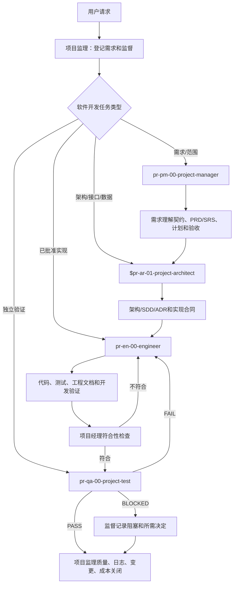
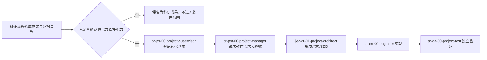
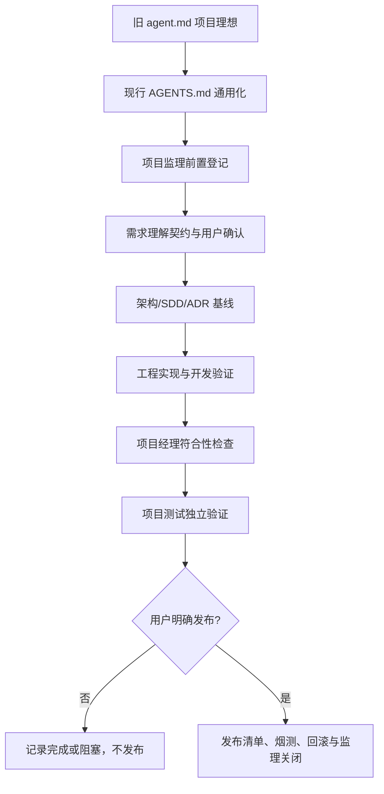

# AI4PROGRAMMING 项目治理与软件开发流程机制说明

## 1. 检查范围与结论

本文依据当前 AI4PROGRAMMING 模板的根级 `AGENTS.md`、工程级 `projectname/project/AGENTS.md`、`PROGRAMMING_STANDARDS.md`、既有 Agent 使用说明、全局项目监理规范、项目管理记录和工程目录进行检查。

当前模板已经形成“根级治理 + 工程级执行 + 项目管理成效”的两层协同结构：根级文件负责项目监理、角色路由、目录边界、需求/设计/实现/测试闭环和发布授权；工程级文件负责代码、数据、数据库、测试、脚本和技术文档的局部执行。

检查结论为“治理框架已建立，真实软件项目仍需试点验证”。根级配置可以解析，项目监理入口、角色调用、文件归属、日志/反思/需求记录、新功能登记和质量门已经写入规则；当前模板没有真实产品需求、业务代码、API、运行服务或测试结论，不能把占位文件和静态规则称为软件功能完成。

## 2. 当前有效的 `AGENTS.md`

检查到三个相关文件：

| 文件 | 实际作用 | 是否作为当前入口 |
| --- | --- | --- |
| `AI4PROGRAMMING/AGENTS.md` | 通用软件开发项目根级治理、项目监理、Agent 路由、成效归档和质量门 | 是，唯一根级入口 |
| `AI4PROGRAMMING/projectname/project/AGENTS.md` | 软件工程目录局部规则：代码、测试、数据库、配置、脚本、文档和工程交付 | 是，进入 `project` 后叠加生效 |
| `AI4PROGRAMMING/agent.md` | 历史兼容说明和旧版单项目流程材料 | 否，不作为第二根级入口 |

进入 `projectname/project` 时，先读取根级 `AGENTS.md`，再读取工程级 `AGENTS.md` 和 `PROGRAMMING_STANDARDS.md`。根级不能被工程级取消；工程级只能补充和收紧工程边界。

## 3. 目录和配置如何实现

根级 `AGENTS.md` 内含可解析的 `project-supervision` 配置块。配置使用项目相对路径，避免把机器绝对路径写入模板：

| 配置项 | 当前配置 | 作用 |
| --- | --- | --- |
| `project_management_root` | `projectname/achieve/00-项目管理` | 正式项目管理记录根目录 |
| `engineering_root` | `projectname/project` | 软件实施目录 |
| `programming_standard` | `projectname/project/PROGRAMMING_STANDARDS.md` | 工程编程规范 |
| `project_skills_root` | `projectname/project/.codex/skills` | 项目级 Skill |
| `scripts_root` | `projectname/project/scripts` | 项目脚本工具 |
| `feature_registry` | `projectname/project/config/feature-registry.yaml` | 功能身份登记 |
| `skill_promotion_registry` | `projectname/project/config/skill-promotion.yaml` | 项目 Skill 晋升证据登记 |
| `release_root` | `projectname/project/release` | 经授权的发布资产 |
| `evolution_review_days` | `14` | 周期演化评估周期 |
| `repeat_problem_threshold` | `3` | 重复问题触发演化评估阈值 |

配置由全局 `pr-ps-00-project-supervision` 工具按显式项目根解析。生成器默认只预览，提供 `--write` 才写入；同名目标拒绝覆盖，路径越出项目根或配置缺失时阻塞。

## 4. 需求记录机制

### 4.1 需求何时登记

下列事件均要在专业工作开始前调用 `pr-ps-00-project-supervisor` 并逐条登记：

- 新的软件想法或新项目启动；
- 新功能、需求追加、范围变更或撤回；
- 公共 API、数据库、权限、部署、配置或验收标准变化；
- 用户指出的问题、冲突、缺陷或继续上次未完成任务。

### 4.2 需求记录内容

每项需求进入 `projectname/achieve/00-项目管理/requirements/`，至少包含：

| 字段 | 内容 |
| --- | --- |
| 稳定 ID | `UC-*`、`FR-*`、`DATA-*`、`INT-*`、`NFR-*`、`OPS-*`、`CON-*` 或项目批准的等价 ID |
| 原意与来源 | 用户原话、日期/轮次、相关证据 |
| 范围 | Must、Should、Could、Won't now，非目标和影响对象 |
| 可验证行为 | 触发、输入、输出、失败行为、Given/When/Then 验收 |
| 责任与状态 | 责任人、依赖、风险、待决策项和关闭决定 |
| 追踪关系 | 对应设计、实现任务、测试用例和保留证据 |

项目经理使用 `$pr-pm-01-project-manager-socratic-discovery` 处理含糊或会改变范围的要求，形成 Requirements Understanding Contract；用户确认后，使用 `$pr-pm-02-project-manager` 生成或修订 PRD/SRS。需求记录不是聊天摘要，需求变化追加记录，不覆盖历史。

### 4.3 当前实现状态

已有治理需求记录工具和本次 `20260913-软件开发模板治理-需求记录.md`。模板项目尚无真实产品需求；因此当前只能确认机制和模板可用，不能声称某个功能需求已经批准。

## 5. 日志机制

### 5.1 三类日志分工

| 日志 | 记录内容 | 位置 | 负责人 |
| --- | --- | --- | --- |
| 项目监管事实日志 | 项目操作做了什么、为什么做、影响、验证、风险和下一步 | `projectname/achieve/00-项目管理/logs/` | `pr-ps-00-project-supervisor` / `pr-ps-03-project-logging` |
| 工程运行日志 | 某次服务、CLI、测试、迁移或运行批次的 request/trace/version、结果和错误 | `projectname/project/logs/` 或批准的 `output/<类型>/<run-id>/` | 工程实现和运行工具 |
| 工具/服务运行日志 | 运行时结构化日志、审计和指标 | 工程 `apps/api/src/observability/`、`project/logs/` 等既有责任目录 | 工程服务/运维流程 |

三类日志不能混用。项目管理日志不保存真实业务日志；工程运行日志不替代需求、监督或项目关闭记录。

### 5.2 每次操作如何记日志

项目监理在操作前建立监督记录，操作后更新事实日志、变更、质量和成本记录。项目日志至少写明：

- 任务/需求 ID、目标和非目标；
- 实际动作、实际修改路径、命令、结果和证据；
- `why`、`expected_impact`、`actual_impact`；
- `affected_requirements`、`affected_files`、`affected_downstream`、`decision_basis`；
- 未执行项、阻塞、残余风险、成本时间和下一步。

日志只能写观察到的事实；没有可靠计时、费用、测试或发布证据时写“未采集”或“未执行”。失败、跳过、环境阻断和部分完成也要记录，不能只记录成功。

### 5.3 当前实现状态

项目监理模板 `20260912-项目工作-日志模板.md` 已包含原因和影响字段，本次治理日志已按该结构记录根级 `AGENTS.md`、工程级 `AGENTS.md` 和功能登记模板的实际影响。工程模板的 `logs/` 只保留说明和 `.gitignore`，不提交真实运行日志。

## 6. 反思机制

### 6.1 触发条件

调用 `$pr-ps-04-reflection-loop` 的条件包括：用户明确要求复盘；确认缺陷或回归；同类错误重复；质量门阻塞；需求、规则、实现或项目路径偏离；显著返工；权限或目录规则遗漏。

一般成功只写日志，不自动生成反思，也不自动升级全局 Skill。

### 6.2 反思内容与位置

反思使用项目管理反思模板，写入当前项目的 `reflections/`，命名为 `YYYYMMDD-内容简述-反思.md`。至少包含：问题 ID、期望与实际、影响、证据、根因分类（需求/流程/规则/实现/数据/环境）、临时处置、最小改进、责任人、验证、试点、回滚和是否建议 Skill 演化。

反思不覆盖历史记录。涉及全局规则、权限、目录迁移或新 Skill 时，只能形成建议，必须经独立评审和人工批准后试点。

当前 `projectname/achieve/00-项目管理/reflections/` 尚未生成项目反思实例，因为本次检查未确认产品缺陷、回归或质量阻塞。该目录应在首份真实反思产生时创建；“没有反思文件”表示尚未触发，不表示机制缺失或所有项目风险已经消失。

### 6.3 周期演化

达到 14 天评估周期或同类问题累计 3 次后，调用 `$pr-ps-08-evolution-review` 汇总需求、问题、反思、质量、成本、返工和误触发，评估保留、优化、合并或淘汰规则。监理不能自动修改全局 Agent、Skill、权限策略或项目基线。

## 7. 所有类型文件命名规范

命名顺序是“先确定责任和目录，再确定文件名”。新类型未登记前不能直接创建。

| 文件类型 | 命名规则 | 归属/备注 |
| --- | --- | --- |
| 管理、产品、技术、测试、验收、阶段文档 | `YYYYMMDD-内容简述-文档类型.扩展名` | 正式材料进入 `achieve` 对应目录 |
| 需求记录 | `YYYYMMDD-内容简述-需求记录.md` | `requirements/` |
| 监督记录 | `YYYYMMDD-内容简述-监督记录.md` | `supervision/` |
| 项目日志 | `YYYYMMDD-内容简述-日志.md` | `logs/` |
| 反思 | `YYYYMMDD-内容简述-反思.md` | `reflections/` |
| 变更记录 | `YYYYMMDD-内容简述-变更记录.md` | `changes/` |
| 质量门禁 | `YYYYMMDD-内容简述-质量门禁.md` | `quality/` |
| 成本时间统计 | `YYYYMMDD-内容简述-统计.md` | `costs/` |
| Skill 提案/说明 | `YYYYMMDD-内容简述-技能提案.md` 或 `技能说明.md` | `skills/` |
| 脚本 API 说明 | `YYYYMMDD-工具简述-API说明.md` | `tools/`，必须与脚本同批生成 |
| 新文档类型登记 | `YYYYMMDD-内容简述-文档类型登记.md` | `templates/`，先登记后建模板 |
| PRD/SRS/架构/SDD/ADR | `YYYYMMDD-内容简述-文档类型.md`；ADR 可保留工程约定固定入口 | `achieve/02-架构与设计/` 或工程 `docs/` |
| 用户手册/阶段报告/发布说明 | `YYYYMMDD-内容简述-文档类型.md` | `achieve/04-交付与阶段/` |
| TypeScript/JavaScript 文件 | 工程规范的 `kebab-case` | `project` 既有责任目录 |
| TypeScript/JavaScript 函数、变量 | `camelCase` | 由 `PROGRAMMING_STANDARDS.md` 约束 |
| 类型、类、错误 | `PascalCase`，错误通常以 `Error` 结尾 | 工程编程规范 |
| 常量 | `UPPER_SNAKE_CASE` | 仅用于真正常量 |
| 测试 | 文件按工程约定；测试名称表达条件和结果 | `tests/` 或各应用测试目录 |
| Schema/契约 | `<领域>_<对象>_v<主版本>.<格式>` | `packages/contracts/` 或批准的契约目录 |
| 数据、迁移、模型、运行产物 | 遵循工程规范，使用版本、范围或稳定 `run-id` | `database/`、`output/` 等责任目录 |
| Skill 目录和 `name` | `<代号>-<英文技能名称>`，小写字母/数字/连字符 | `.codex/skills/`，入口固定 `SKILL.md` |

固定工具链名称如 `AGENTS.md`、`README.md`、`PROGRAMMING_STANDARDS.md`、`package.json`、锁文件、`SKILL.md`、`docs/*/README.md` 可以保留稳定名称，但不免除目录归属、中文治理正文、版本/变更记录、功能身份和质量验证。代码文件不能为了添加功能编号而破坏语言的可导入命名；编号、代码和功能名应登记在功能注册表、模块 docstring 或相邻契约中。

## 8. 新文件去处和归属

### 8.1 正式成效目录

| 文件责任 | 目录 |
| --- | --- |
| 需求理解契约、PRD、SRS、功能总览 | `projectname/achieve/01-需求与产品/` |
| 架构方案、SDD、ADR、API/数据设计 | `projectname/achieve/02-架构与设计/` |
| 对齐检查、测试报告、验收材料 | `projectname/achieve/03-测试与验收/` |
| 用户手册、阶段报告、发布说明 | `projectname/achieve/04-交付与阶段/` |
| 监督、需求、日志、反思、质量、变更、成本、Skill、工具、模板 | `projectname/achieve/00-项目管理/` 对应子目录 |

这些目录只在具体项目首份产物确有需要时创建。已有目录、`.gitkeep` 和占位文件不因本次检查移动或删除。

### 8.2 工程实施目录

当前工程级 `AGENTS.md` 已定义以下归属：

| 文件责任 | 目录 |
| --- | --- |
| Web 页面、路由、feature | `apps/web/src/` |
| Web 公共静态资源 | `apps/web/public/` |
| API 路由和 DTO | `apps/api/src/api/` |
| 业务规则 | `apps/api/src/domain/` |
| 用例编排 | `apps/api/src/application/` |
| 数据库/队列/外部服务接口 | `apps/api/src/ports/` |
| 数据库、缓存、外部 API 实现 | `apps/api/src/adapters/` |
| 日志、指标、追踪和审计 | `apps/api/src/observability/` |
| 异步任务 | `apps/worker/` |
| OpenAPI、JSON Schema、事件 | `packages/contracts/` |
| 共享 UI、配置、SDK | `packages/ui/`、`packages/config/`、`packages/sdk/` |
| 数据库 schema、迁移、种子 | `database/schema/`、`database/migrations/`、`database/seeds/` |
| 非敏感配置 | `config/` |
| 架构/API/开发/运维文档 | `docs/` |
| 工程测试 | `tests/`、各应用测试目录 |
| 仓库级脚本 | `scripts/` |
| 发布和部署资产 | `release/` |
| 运行时日志 | `logs/`，只保留 `.gitignore` 和说明 |
| 上传、缓存、临时文件 | `storage/`，使用挂载点，禁止提交真实数据 |

不能确定归属时先形成文件放置决策或 ADR，不能自行创建平行的 `frontend/`、`backend/`、`utils/`、`common/`、`temp/` 等模糊目录。

## 9. 新 Skill 和脚本生成规则

### 9.1 新 Skill

只有重复问题有证据、现有 Skill 无法覆盖、规则可以迁移、输入/输出/失败边界清楚、收益可测且维护人明确时，才能提出新 Skill。

具体步骤：

1. `pr-ps-00-project-supervisor` 登记需求、问题、证据、影响和非目标。
2. 使用 `$pr-ps-05-skill-authoring` 或 `$pr-ps-08-evolution-review` 形成技能提案。
3. 分配当前项目唯一代号，目录和 frontmatter `name` 使用 `<代号>-<英文技能名称>`。
4. 明确单一职责、触发条件、非目标、输入、输出、权限、失败边界、幂等/并发、维护人、验证和回滚。
5. 凡输出 Markdown、HTML、报告、日志、说明或其他文档，必须在 Skill 的 `assets/` 放置中文空白模板，并在 `SKILL.md` 写清模板选择、正式输出命名和项目落点。
6. 先小范围试点，再做正常、边界、无效输入、失败、重复执行、权限和误触发验证；独立评审和人工批准后才能启用或晋升全局。

项目 Skill 放在 `projectname/project/.codex/skills/<代号>-<英文技能名称>/`；技能说明、提案和演化证据放在 `projectname/achieve/00-项目管理/skills/`。全局 Skill 不能保存具体项目日志，也不能未经批准复制进全局目录。

当前模板没有实际项目级 Skill，`.codex/skills/` 和项目管理 `skills/` 也未为占位而创建；这符合“首个具体产物出现时才建目录”的规则。已验证的是全局生成器、命名、路径和模板契约，不是某个新 Skill 已经实现或启用。

### 9.2 新脚本工具

新脚本只用于可重复、确定性的操作，必须使用参数化相对路径，默认预览，显式 `--write` 才写入；不隐式联网、读取凭据、覆盖、提交、推送或发布。Python 脚本、函数/变量、类和常量遵循工程编程规范。

脚本与中文 API 说明同批规划：

```text
projectname/project/scripts/<snake_case名称>.py
projectname/achieve/00-项目管理/tools/YYYYMMDD-内容简述-API说明.md
```

API 说明至少写版本、责任人、源文件、用途、调用、参数、输入输出、退出码、错误、安全、幂等、并发、示例、测试、兼容、变更和回滚。全局 `ps_03_create_script_tool.py` 默认只预览，脚本和 API 任一目标已存在就整体拒绝覆盖。

当前工程 `scripts/` 只有模板占位，没有项目脚本工具；因此没有对应的项目 API 说明。只有出现明确、可重复的脚本需求并完成生成、实现和验证后，才能把脚本标记为可用。

### 9.3 新文档类型

现有模板不能表达的新文档，先使用 `ps_01_create_governance_document.py --type document-type` 登记名称、目的、负责人、命名、落点、字段、证据、保留、敏感性、验证和归档；再在适用 Skill 的 `assets/` 建立中文空白模板，最后生成正式文档。不得先产出正式文件再补模板。

## 10. 三层 Agent 的协同运行



协同规则是：

1. 根级 `AGENTS.md` 先生效，工程目录再叠加工程级 `AGENTS.md`；历史 `agent.md` 只供兼容阅读。
2. 项目监理负责进入和退出，不代替专业 Agent 做产品、架构、编码或验收决定。
3. 项目经理负责需求所有权和交付协调；架构师能力负责可实施设计；工程师负责实现；项目测试负责独立只读验证。
4. 需求、架构、代码、测试、验收和发布使用稳定 ID、相对路径和证据互相追踪。
5. 任何角色发现范围、架构、接口、数据或权限变化，都必须暂停当前分支并返回项目经理/架构师；不能静默重设计。

## 11. 软件项目监管的具体闭环

### 操作前

项目监理定位根级 `AGENTS.md`，读取目标目录的规则、编程规范、近期日志和工作区状态；将用户要求逐条登记；建立监督记录和文件放置清单；确认是否涉及删除、覆盖、发布、凭据、付费、外部写入或真实数据；未授权高风险动作直接阻塞。

### 操作中

专业 Agent 只能修改已登记范围。项目经理维护需求基线；架构师维护设计基线；工程师按 SRS/SDD 实现并运行开发验证；项目测试使用隔离数据、服务和 `output/<类型>/<run-id>/` 证据执行独立验证。新发现的必要范围先补需求或变更记录。

### 操作后

项目监理核对实际文件、命名、归属、命令、结果、未执行项、风险、回滚和用户影响；更新日志、变更、质量、成本和必要反思。只有需求有状态、产物真实存在、质量证据齐全、失败和限制已明确记录，才能关闭监督记录。

## 12. 软件开发流程和质量门

### 12.1 新项目流程

1. 替换项目名并检查两层 `AGENTS.md`、编程规范、README、目录和工具链。
2. 调用 `pr-ps-00-project-supervisor` 登记项目启动需求、范围、责任、路径、权限和验收。
3. 调用项目经理做需求发现；用户确认 Requirements Understanding Contract 后形成 PRD/SRS、计划、风险和验收。
4. 需求稳定时调用 `$pr-ar-01-project-architect` 形成架构方案、SDD、ADR、接口/数据/迁移和验证挂钩。
5. 设计批准后调用 `pr-en-00-engineer` 按工作契约实现；项目经理检查需求/设计符合性。
6. 项目经理检查通过后调用 `pr-qa-00-project-test`，在隔离环境执行 API、数据、CLI/UI、错误、恢复和兼容性验证。
7. `PASS` 后由项目监理完成质量、日志、变更、成本和关闭；`FAIL` 回派工程师；`BLOCKED` 记录阻塞和人工决定。
8. 只有用户明确发布命令，才由项目经理准备版本包、变更说明、迁移/配置、烟测、回滚和发布记录。

### 12.2 质量门

| 层级 | 检查对象 | 软件项目最低证据 |
| --- | --- | --- |
| L1 静态 | 路径、命名、UTF-8、配置、绝对路径、秘密和链接 | 扫描/格式/lint 结果 |
| L2 单元/契约 | 正常、边界、无效输入、错误、幂等、兼容 | 测试结果和失败清单 |
| L3 集成 | 真实数据库、队列、适配器、迁移、进程、日志 | 隔离环境运行证据 |
| L4 用户路径 | CLI、HTTP、UI、持久化、权限、刷新、恢复 | 可观察响应/状态/截图/trace（适用时） |
| L5 交付发布 | 版本、文档、许可证、清单、回滚、烟测 | 交付清单和复核结果 |

项目经理的符合性检查不等于独立测试，代码存在、HTTP 200、单元测试通过、静态截图或历史报告不单独证明完整用户路径。

### 12.3 当前模板的真实边界

当前工程目录仍是空白网页工程模板：无真实产品需求、业务数据库表、可用 API、前端页面、生产部署和真实测试结果。已验证的是规则、配置、模板、文件路径和角色流程；未验证的是具体产品功能、性能、安全扫描、浏览器交互、发布包和正式用户验收。

### 12.4 与科研流程的边界和衔接

AI4PROGRAMMING 不定义也不替代 AI4SCIENCE 的科研问题、文献、假设、实验、结果分析和论文评审工作流。纯软件项目不调用科研 Agent；涉及“科研成果转为软件功能”时，先由相应科研流程形成有证据边界且经人确认的转化目标，再交给 `pr-pm-00-project-manager` 建立软件需求。科研成果、论文或图表只能作为需求背景证据，不能直接当作已批准的软件需求、已实现功能或测试通过。



### 12.5 `agent.md` 中项目理想、更新需求和版本发布的实现对照

旧版 `agent.md` 表达的是“项目经理确认需求、架构师设计、工程师实现、项目经理对齐、测试员回归、用户明确后发布”的项目理想。现行根级 `AGENTS.md` 没有丢弃这条主线，而是把它改造成适用于一般软件项目、可审计且有权限边界的执行合同：每次进入专业工作前后增加项目监理门；用稳定需求/功能/测试 ID 和相对路径替代固定产品路径；把“完成”拆成需求状态、设计基线、实现证据、独立测试和关闭记录。

| 旧版 `agent.md` 条款 | 现行实现 | 不能直接继承的部分 |
| --- | --- | --- |
| 项目理想：项目经理牵头，架构师、工程师、测试员串联交付 | 根级 `AGENTS.md` 的角色表、工作合同、项目经理符合性检查和项目测试独立验证共同实现；`projectname/project/AGENTS.md` 只执行工程局部职责 | 旧版把特定科研工作台、固定团队文件和服务假设写进流程；一般项目不自动拥有这些产品事实 |
| 项目立项：先确认想法和需求，再写需求文档、架构设计、开发和测试 | 先由 `pr-ps-00-project-supervisor` 登记需求和权限，再由 `pr-pm-01-project-manager-socratic-discovery` 形成需求理解契约，用户确认后生成 PRD/SRS，随后架构、工程、测试按质量门推进 | 旧版没有独立的监督前置/后置记录、稳定 ID、阻塞状态和证据要求；这些由现行治理补齐 |
| 更新需求：区分新增需求和继续开发，更新想法/需求后重新设计并循环开发测试 | 新需求、范围变化、接口/数据/权限变化都追加到 `requirements/`；必要时重新进入架构评审；工程和测试循环必须回链到需求与变更记录 | 旧版固定的 `idea/idea.md`、`log/readme.md`、上下文服务地址只属于旧项目，不是模板级落点 |
| 版本发布：用户明确要求后打包源代码、说明、数据、文档、手册和报告 | 项目监理先登记版本范围和授权，项目经理形成发布清单/变更说明/迁移与回滚方案，工程资产进入 `project/release/`，正式发布文档进入 `achieve/04-交付与阶段/`，项目测试完成烟测，监理最后关闭发布记录 | 模板当前没有真实产品、数据或 `data_release/`；数据包、上传平台、许可证排除项、部署重启等必须作为具体项目需求和发布授权单独批准，不能由旧文档自动触发 |

因此，旧 `agent.md` 中“更新需求”的实际执行顺序是：登记变更 -> 需求经理澄清并确认 -> 必要时架构变更 -> 工程实现 -> 项目经理对齐 -> 独立测试 -> 监理关闭；“版本发布”的实际执行顺序是：用户明确授权 -> 监理登记版本边界 -> 项目经理编制清单和发布说明 -> 工程师准备发布资产 -> 测试员烟测/回滚验证 -> 监理记录结果。没有用户明确授权时，流程最多停在可审查的候选发布包，不得上传、部署、重启或覆盖外部系统。



旧版中的回归清单、固定产品截图、服务重启和平台上传规则仍可作为具体项目的候选经验，但必须先转写成当前项目的需求、设计、测试或发布合同，并补上权限、证据和回滚边界。它们不会因为存在于历史 `agent.md` 就自动对所有新项目生效。

### 12.6 对齐审计后的运行性优化

根据同日治理对齐审计，模板新增了两个只读工程门：`F001` 校验功能三元组、实现/测试路径、工程顶层目录、项目管理文档命名和项目文档型 Skill 的模板链路；`F002` 校验项目 Skill 晋升的提案、试点、独立评审、安全、人工批准、安装记录、回滚和文件树哈希。两者都要求显式项目根，默认只读，不能安装 Skill、发布、部署或替代人工批准。

全局 `pr-pm-00-project-manager`、`pr-en-00-engineer`、`pr-qa-00-project-test` 和已注册的 `pr-ar-00-project-architect` Agent 现以目标项目的 `AGENTS.md` 为默认事实来源；架构 Agent 的专业实现由 `$pr-ar-01-project-architect` 提供。一般软件项目使用通用 `$pr-qa-01-software-project-functional-qa` 和 `$pr-rl-01-software-project-release-management`，两者均有中文随附模板；只有项目明确识别为 ScienceResearch 且专用基线存在时，才进入科研专用 Skill 分支。这样保留领域能力，同时避免通用软件项目被固定科研路径或旧日志规则劫持。

当前优化证据为：F001/F002 均返回 `ERROR=0`，两个脚本的回归测试通过，两个通用 Skill 通过结构校验，四个全局 Agent TOML 可解析。它们只证明治理配置与证据链处于一致状态；真实项目的业务正确性、浏览器用户路径、实质 Skill 晋升和版本发布仍须在首个派生项目中单独验证。

## 13. 检查记录与后续建议

本说明对应本次项目管理记录：

- 需求：`../requirements/20260913-AI4PROGRAMMING机制检查说明-需求记录.md`；
- 监督：`20260913-AI4PROGRAMMING机制检查说明-监督记录.md`；
- 日志：`../logs/20260913-AI4PROGRAMMING机制检查说明-日志.md`；
- 质量：`../quality/20260913-AI4PROGRAMMING机制检查说明-质量门禁.md`；
- 变更：`../changes/20260913-AI4PROGRAMMING机制检查说明-变更记录.md`。
- 成本：`../costs/20260913-AI4PROGRAMMING机制检查说明-统计.md`。

建议真实新项目第一次运行时，先完成一次只读治理演练：登记首个功能、运行需求发现、形成最小 SRS、进行架构评审、输出工程工作契约，再决定是否实施。不得因为模板已有目录或 `.gitkeep` 就宣称功能、需求或测试已经完成。

## 14. 变更记录

| 版本 | 日期 | 变更摘要 | 责任人 | 状态 |
| --- | --- | --- | --- | --- |
| v1.1 | 2026-09-13 | 增加旧版 `agent.md` 项目理想、需求更新、版本发布与现行治理的实现对照，明确历史规则和具体项目发布特例边界 | 项目监理、项目经理 | 待用户审核 |
| v1.2 | 2026-09-13 | 根据治理对齐审计补充通用 Agent 路由、F001/F002 只读门、通用 QA/发布 Skill 和验证边界 | 项目监理、项目经理 | 待用户审核 |
| v1.0 | 2026-09-13 | 检查并说明 AI4PROGRAMMING 的日志、反思、需求、命名、归属、Skill、AGENTS 协同和软件项目监管流程 | 项目监理、项目经理 | 已被 v1.1 替代 |
