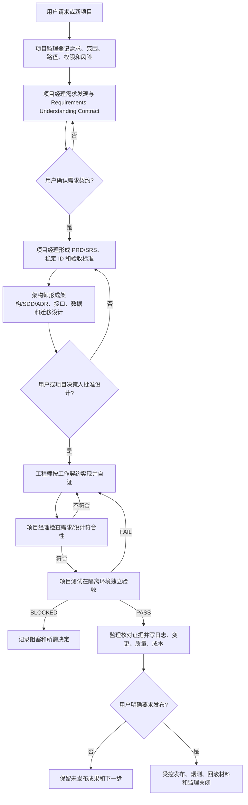

# 软件项目 Agent 协作与交付流程说明

## 1. 目的、适用范围和结论

本文把当前根级 `AGENTS.md`、工程级 `projectname/project/AGENTS.md` 和 `reference/` 中的 Agent 使用说明整理成一份可执行的项目流程说明。它回答三个问题：

1. 一个软件项目从想法到发布要经过哪些角色和关口；
2. 需求、设计、实现、测试、证据和项目管理记录如何交接；
3. 哪些事情必须由用户明确决定，不能由 Agent 自动代办。

适用对象是需要前端、API、数据、迁移、测试、运维文档和受控发布的通用软件项目。本文是流程说明，不是需求基线、架构批准、实现完成、测试通过或发布授权。派生项目开始后，应以本项目自己的 `AGENTS.md`、PRD/SRS、SDD/ADR、测试记录和用户决定为准。

当前模板已经具备治理框架；真实项目仍需通过首个需求完成试点验证。占位目录、规则文件和历史参考不能被描述为已实现产品功能。

## 2. 总体流程



核心原则是：**先监理登记，再专业执行；先需求确认，再设计和实现；先独立验收，再宣称交付；先用户明确授权，再发布。**

## 3. 目录和记录边界

| 内容 | 正式位置 | 用途 |
| --- | --- | --- |
| 根级治理入口 | `AGENTS.md` | 项目监理、角色路由、目录边界、质量门和人工授权 |
| 工程实施 | `projectname/project/` | 源代码、契约、迁移、测试、配置、脚本和工程文档 |
| 项目成效 | `projectname/achieve/` | 需求、架构、测试验收、用户手册、阶段报告、发布说明 |
| 项目管理记录 | `projectname/achieve/00-项目管理/` | 需求、监督、日志、反思、变更、质量、成本、Skill、工具和模板 |
| 需求与产品 | `projectname/achieve/01-需求与产品/` | 需求理解契约、PRD、SRS、功能总览 |
| 架构与设计 | `projectname/achieve/02-架构与设计/` | 架构方案、SDD、ADR、API/数据设计 |
| 测试与验收 | `projectname/achieve/03-测试与验收/` | 项目经理对齐检查、独立测试、验收材料 |
| 交付与阶段 | `projectname/achieve/04-交付与阶段/` | 用户手册、阶段报告、发布说明 |
| 运行证据 | `projectname/project/output/<类型>/<run-id>/` | 浏览器、集成、性能和临时数据库证据 |

管理、技术、测试、验收和发布文档使用 `YYYYMMDD-内容简述-文档类型.扩展名`。同名不覆盖，必须使用新日期或稳定运行 ID。代码、测试、配置和脚本仍遵循工程级 `AGENTS.md` 与 `PROGRAMMING_STANDARDS.md`，不得把功能编号强行破坏可导入名称。

## 4. 角色分工和停止条件

| 角色 | 调用方式 | 主责 | 不能做的事 | 交回条件 |
| --- | --- | --- | --- | --- |
| 用户/项目决策人 | 明确请求、确认、授权 | 决定需求边界、架构取舍、高风险操作、正式验收和发布 | 不代替 Agent 伪造执行证据 | 对关键决定给出确认或修改意见 |
| 项目监理 | `pr-ps-00-project-supervisor` + `$pr-ps-00-project-supervision` | 需求登记、路径和命名监督、日志、质量门、反思和关闭 | 不批准产品需求、架构、代码质量或正式验收 | 规则冲突、目标路径不清、质量门错误未处置 |
| 项目经理 | `pr-pm-00-project-manager`，发现用 `$pr-pm-01-project-manager-socratic-discovery`，成文用 `$pr-pm-02-project-manager`，审计用 `$pr-pm-03-project-alignment-audit` | 需求所有权、范围、稳定 ID、验收、计划、风险、对齐检查 | 不实现代码，不替代独立测试 | 需求不清、验收不可测、范围冲突、发布未授权 |
| 项目架构师 | `pr-ar-00-project-architect` + `$pr-ar-01-project-architect` | 边界、模块、接口、数据、迁移、质量属性、SDD/ADR | 不改写需求，不实现代码，不擅自引入新技术 | 需求矛盾、验收不可测、架构决策需用户批准 |
| 全栈工程师 | `pr-en-00-engineer` + `$pr-en-01-fullstack-design-engineer` / `$pr-en-02-senior-engineer` | 按批准范围实现、开发验证、文档同步、缺陷修复 | 不自定范围，不把自测当独立验收，不绕过架构 | 需求歧义、接口/数据/权限/部署边界需变化 |
| 项目测试 | `pr-qa-00-project-test` + `$pr-qa-01-software-project-functional-qa`，界面用 `$playwright` | 隔离环境中的 API、数据、用户路径、浏览器、错误和恢复验证 | 只读验收，不修改产品代码，不改失败为通过 | 环境阻断、需求/SDD 缺口、High/Critical 缺陷 |
| 发布管理 | 用户明确授权后使用 `$pr-rl-01-software-project-release-management` 或项目批准专用 Skill | 版本清单、发布包、说明、校验、烟测和回滚 | 不自动部署、上传或把内部材料放入发布包 | 版本范围、许可证、数据、外部系统权限未确认 |

## 5. 新项目启动流程

### 5.1 建立项目实例

1. 复制或派生模板，把 `projectname` 替换为经批准的项目名。
2. 确认根级 `AGENTS.md`、工程级 `project/AGENTS.md`、`PROGRAMMING_STANDARDS.md`、README 和目录契约可读。
3. 只在第一份具体记录或产物产生时创建对应目录，不为填满模板批量创建空目录。
4. 不把本机绝对路径、真实秘密、生产数据或未确认产品事实写入项目规则。

### 5.2 首次登记

项目监理读取最近根级和目标目录 `AGENTS.md`，登记：

- 用户本轮每条要求；
- 操作范围和非目标；
- 目标路径和文件归属；
- 权限、副作用和风险；
- 验证方式、停止条件和日志位置；
- 现有工作区状态，避免覆盖他人修改。

没有项目监理记录时，不应进入需求成文、架构设计、编码或测试。

## 6. 需求阶段

### 6.1 需求发现

项目经理读取现有需求、设计、日志、测试、用户手册和仓库证据，使用苏格拉底式发现澄清：

- 用户和目标；
- 触发条件和输入；
- 期望输出和状态变化；
- 失败行为；
- 范围、非目标和优先级；
- 权限、数据、成本、兼容性和部署影响；
- Given/When/Then 验收。

项目经理一次只确认一个会改变范围、验收、架构、成本或权限的关键决定，形成 Requirements Understanding Contract。契约未获用户确认前，不冻结 PRD/SRS，不派发架构或实现。

### 6.2 PRD/SRS

用户确认契约后，项目经理形成带稳定 ID 的 PRD/SRS：

- Must / Should / Could / Won't now；
- 用户路径、输入、输出、错误和持久化行为；
- 非功能指标和约束；
- 依赖、风险和失败行为；
- 每项 Must 的可观察验收方法；
- 交接给架构师、工程师和测试员的最小包。

需求记录进入 `requirements/`，历史变化追加，不覆盖。科研成效卡、论文、历史截图或聊天记录只能作为背景证据，不能直接当作已批准软件需求。

## 7. 架构与设计阶段

需求/SRS 稳定后，项目架构师读取仓库、测试、运行约束和质量属性，输出架构方案、SDD 或 ADR，至少覆盖：

- 系统边界、信任边界和部署单元；
- 模块责任与依赖方向；
- API、文件或事件契约；
- 数据所有权、schema、索引、事务、迁移、回填和恢复；
- 错误、权限、配置、观测、安全和回滚；
- 测试挂钩、实施阶段和验收门；
- 关键取舍的至少两个候选方案、推荐、代价和反转条件。

接口、数据、约束和测试挂钩必须追溯到 SRS 需求 ID。架构师发现需求不可测或验收不清时退回项目经理，不能通过设计假设补造需求。

设计经用户或项目决策人批准后，才能进入实现。设计未批准前，工程师不得提前编码。

## 8. 实现阶段

工程师接收已批准需求/设计 ID 和工作契约，先说明：

- 输入基线和输出产物；
- 需求/SRS/SDD ID；
- 文件放置清单；
- 完成标准和停止条件；
- 回归影响、测试命令和回滚方式；
- 需要用户检查的点。

新增功能、公共接口、迁移、配置能力和用户路径先登记 `config/feature-registry.yaml` 的 `feature_id`、`feature_code`、`feature_name`、责任人、实现路径、测试路径和状态。工程变更前后运行 F001 只读检查。

默认实施顺序：

1. 契约/schema；
2. domain；
3. application；
4. ports/adapters；
5. API/页面；
6. 单元、契约、集成、E2E 测试；
7. 文档、用户手册和 CHANGELOG；
8. 发布前质量门。

有 UI 时必须使用真实浏览器检查可见反馈、表单、错误、空态、刷新持久化、键盘、焦点、Console、PageError 和多视口。无 UI 时不虚构浏览器证据。测试数据库、浏览器 profile、截图、trace 和临时产物放在 `project/output/<类型>/<run-id>/`。

实现中发现需求、接口、数据、权限或部署边界需要变化时，工程师停止当前分支，退回项目经理和架构师，不得静默重构。

## 9. 对齐检查和独立验收

### 9.1 项目经理符合性检查

工程师报告完成后，项目经理按 PRD/SRS/SDD 检查：

- 是否实现全部 Must，未实现项是否明确降级或延期；
- 用户路径是否可达、可观察、可恢复；
- API/页面/数据状态是否一致；
- 文档、配置、迁移和功能登记是否同步；
- 是否引入未批准范围或架构偏差。

检查不通过时，按偏差 ID 回派工程师；通过只说明实现符合当前基线，不等于独立验收或用户正式验收。

### 9.2 项目测试独立验收

项目测试从需求、设计和用户手册建立覆盖清单，在隔离数据环境中验证：

- 页面、按钮、链接、表单和 JavaScript 交互；
- HTTP 方法、路径、状态码、Content-Type 和正文结构；
- 成功、无效输入、权限、冲突、重复提交、超时、取消和恢复；
- 页面显示、API 返回和数据库状态一致性；
- 刷新后的持久化；
- Console、PageError、失败请求和响应式布局；
- 日志、回滚和迁移结果。

测试结论只有三种：

| 结论 | 条件 |
| --- | --- |
| `PASS` | 全部 Must 项有可观察证据，且没有 Critical/High 缺陷 |
| `FAIL` | 存在功能错误、无响应入口、错误返回、状态不一致或 Must 未满足 |
| `BLOCKED` | 已完成诊断，但环境仍阻止有意义测试 |

`FAIL` 按缺陷 ID 回派工程师，修复后重新执行项目经理对齐检查和受影响范围复测。不得用旧报告、旧截图、历史计数或“此前通过”覆盖当前状态。

## 10. 记录、反思和演化

每次原子操作或运行批次结束后，项目监理核对实际路径、命令、结果、未执行项、阻塞、风险、回滚和用户影响，并维护：

| 记录 | 回答的问题 | 位置 |
| --- | --- | --- |
| 需求记录 | 用户要求什么、边界和验收是什么 | `requirements/` |
| 监督记录 | 本轮范围、权限、产物、证据和结论是什么 | `supervision/` |
| 项目日志 | 实际做了什么、验证结果和剩余风险是什么 | `logs/` |
| 反思 | 目标与事实为何偏离、最小改进是什么 | `reflections/` |
| 变更记录 | 用户可见和基线变化是什么 | `changes/` |
| 质量记录 | 执行了哪些门禁、结果和限制是什么 | `quality/` |
| 成本记录 | 耗时、返工和成本证据是什么 | `costs/` |

用户指出问题、确认缺陷、回归、重复失败、质量门阻塞或项目偏离时，触发反思。达到 14 天周期或同类问题 3 次时，进行规则/Skill 演化评估。一般成功只写日志，不自动升级为全局规则。

## 11. 分层质量门

| 层级 | 检查内容 | 最低证据 |
| --- | --- | --- |
| L1 | 路径、命名、功能三元组、目录、文档模板、配置、敏感信息、链接和绝对路径 | F001、扫描命令与结果 |
| L2 | 单元、契约、边界、错误、幂等和兼容 | 测试结果与失败清单 |
| L3 | 真实适配器、数据库、迁移、进程、日志和产物 | 隔离环境运行证据 |
| L4 | CLI、HTTP、UI、持久化、恢复和用户路径 | 可观察状态、响应、截图/trace（如适用） |
| L5 | 交付包、文档、许可证、版本、回滚、Skill 晋升和复现 | 清单、F002、复核和烟测结果 |

按风险选择层级，不为项目不存在的能力虚构检查。错误阻断；警告必须有处置决定；未执行必须记录原因。

监理关闭条件是：需求逐条有状态，文件归属和命名合规，实现与测试证据真实存在，失败/阻塞/未执行项已记录，项目经理和项目测试结论清楚，日志、变更、质量和成本记录齐全。`PASS` 仍不代表用户正式验收。

## 12. 需求变更和缺陷修复流程

```text
用户提出变更或缺陷
→ 项目监理登记需求/问题、影响和风险
→ 项目经理判断是否改变需求基线、API、数据、权限、部署或验收
→ 需要时更新 Requirements Understanding Contract、PRD/SRS 和稳定 ID
→ 需要时架构师更新 SDD/ADR、schema、接口或迁移方案
→ 用户批准必要基线变化
→ 工程师按新工作契约实现，先列回归影响和文件放置
→ 工程师运行针对性测试和相关质量门
→ 项目经理重新检查需求/设计符合性
→ 项目测试复测受影响功能和相邻回归范围
→ 项目监理记录结果、变更、成本和必要反思
```

已确认、已实现或已在用户手册/验收证据中展示的功能属于兼容性基线。除非用户明确批准替代或废弃，新功能不得使旧入口悄然消失。每个发现的回归都应有最小自动化资格测试，并说明失败于修复前、通过于修复后的证据。

## 13. 受控发布流程

默认不发布。只有用户明确命令发布后，才能执行：

1. 项目监理登记版本范围、授权和排除项；
2. 项目经理形成发布清单、版本说明、验收状态、风险和回滚方案；
3. 工程师准备经批准的源代码、锁文件、迁移/配置模板、必要文档和发布资产；
4. 项目测试执行发布烟测和关键用户路径验证；
5. 项目监理复核清单、许可证、秘密排除、证据和回滚材料；
6. 发布结果写入 `projectname/project/release/` 与 `projectname/achieve/04-交付与阶段/`；
7. 部署、上传、重启或外部系统写入仅在用户明确授权范围内执行。

发布包不得默认包含真实数据、真实日志、秘密、内部项目管理材料、未授权第三方内容或临时运行产物。发布后如果出现回滚，必须记录回滚原因、版本、验证结果和后续决定。

## 14. 新 Skill、脚本和文档类型

新增 Skill 必须先有重复问题证据和维护责任人，并定义触发、非目标、权限、失败边界、验证和回滚。文档型 Skill 必须在 `assets/` 提供中文空白模板，并由 `SKILL.md` 引用。

新增脚本必须使用参数化路径、安全默认值、幂等/冲突策略和测试，并同批生成中文 API 说明。脚本不得写死机器路径，不得绕过用户授权或项目根边界。

现有模板无法表达的文档类型，先登记用途、负责人、扩展名、命名、目录、模板、保留周期、敏感性、验证和归档规则，再创建中文空白模板，最后产出正式文件。

Skill 生命周期为：候选 → 项目试点 → 独立评审 → 人工批准 → 启用 → 监控 → 优化/合并/淘汰。项目级 Skill 晋升全局前必须有试点、评审、安全扫描、版本/哈希、人工批准和回滚证据，F002 只检查证据，不自动安装。

## 15. 与 reference 历史参考的关系

本文吸收了 `reference/` 中以下通用经验：

| 参考文档 | 保留的通用规则 | 不再直接适用的内容 |
| --- | --- | --- |
| 项目经理 Agent 使用说明 | 需求发现、PRD/SRS、验收、角色交接和发布治理 | ScienceResearch 专用汇报/发布 Skill 名称 |
| 项目架构师 Agent 使用说明 | SDD/ADR、接口、数据、迁移和质量属性设计 | 具体科研项目背景 |
| 全栈工程师 Agent 使用说明 | 文件落位、前后端边界、浏览器验证和输出隔离 | ScienceResearch 专用仓库路径与固定目录 |
| 项目测试 Agent 使用说明 | 独立只读验收、覆盖清单、PASS/FAIL/BLOCKED 和证据目录 | ScienceResearch 专用功能 QA Skill 与固定服务 |
| 项目 Agent 协作说明 | 角色、顺序、回派和发布授权 | 旧版 `log/demand_log.md` 等固定日志路径 |
| 旧版软件项目流程 | 用户确认、回归防错、缺陷回派、发布需授权 | 固定产品名、固定服务地址、自动重启和旧数据发布规则 |

历史参考中的具体产品路径、服务地址、日志文件、数据目录和发布特例，必须先转化为具体项目的需求、设计、测试或发布合同，并在获得授权后才会生效。

## 16. 当前限制和下一步

- 本文描述的是模板流程，不代表已有产品、API、数据库、页面、测试或发布完成。
- 首个真实派生项目应先做只读治理演练：登记首个功能、需求发现、最小 SRS、架构评审和工程工作契约，再决定实施。
- 项目应根据自己的技术栈在工程 README 中建立可复制的安装、格式化、类型检查、测试、构建和运行命令。
- 用户审阅本文后，可决定是否将其作为派生项目流程培训说明或继续压缩为快速上手版。

## 17. 变更记录

| 版本 | 日期 | 变更摘要 | 责任人 | 状态 |
| --- | --- | --- | --- | --- |
| v1.0 | 2026-09-15 | 根据根级 `AGENTS.md`、工程级规则和 `reference/` 文档整理新项目、需求变更、实现、独立验收、记录、质量门和受控发布流程 | 项目经理、项目监理 | 待用户审阅 |
